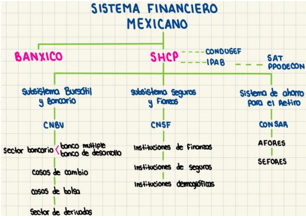

# Tarea 1: Mercados Financieros y SMF

## Introducción a mercados financieros

1. Explicar qué es la colocación privada y la oferta pública.

Cuando una empresa o entidad necesita financiamiento a través de la emisión de instrumentos, tiene dos vías para hacerlos llegar a los inversionistas:

- **Oferta pública**: Es la venta no exclusiva de valores dirigida al público inversionista en general. Este mecanismo permite al emisor acceder a un fondo masivo de capital, ya que relativamente, cualquier individuo o institución puede adquirir los títulos. Esta altamente regulado y usualmente respaldado y asesorado de un banco o casa de bolsa.
- **Colocación privada**: Implica la venta directa de la emisión de valores a un inversionista o a un grupo selecto y reducido, sin ofrecerlos al público en general. De esta forma, se evita gran parte de la estricta regulación y los altos costos de emisión asociados a la oferta pública, y el proceso es mucho más rápido y flexible. La principal ventaja es la falta de liquidez.

1. Puntualiza que es una operación "Repo" y cuál es la ventaja de realizarla para las partes involucradas. Adicione también qué es una repo inverso o contra repo.

Una operación de **reporto** o “Repo” (repurchase agreement) es un contrato mediante el cual una de las partes adquiere de la otra títulos de valor a cambio de una suma de dinero. El emisor se obliga a recomprar esos mismos títulos en un plazo determinado y a un precio convenido. Es decir, es un prestámo a corto plazo el cual la garantía es el activo. Las ventajas para el vendedor es obtener financiamiento inmediato y flexible, además de obtener liquidez; miestras que el comprador representa una inversión a corto plazo altamente segura.

Un repo inverso es la misma operación / instrumento, pero visto desde la perspectiva de la contraparte (el comprador).

1. Qué es el mercado de capitales y explica cómo se subdivide.

El mercado de capitales es el segmento del sistema financiero donde se negocian instrumentos de inversión y financiamiento a largo plazo (mayor a un año). Se puede dividir en:

- Mercado de deuda a largo plazo (Renta fija): Se emiten instrumentos como bonos y cupones. Al adquirir estos instrumentos, el inversionista se vuelve acreedor, la entidad emisora tiene la obligación de pagar interes periódicos y de restituir el capital en la fecha de vencimiento.
- Mercado accionario (Renta variable): Se emiten instrumentos como acciones comunes o preferentes. Quien adquiere una acción no realiza un préstamo, sino que compra una fracción del capital social de la empresa, convirtiendose en copropietario. No hay rendimiento fijo, las ganacias del inversionista dependen de la generación de utilidades de la empresa.

1. Explica si son falsas o verdades las siguientes aseveraciones:

a) El mercado de dinero y el mercado de deuda son sinónimos

Falso. Aunque están relacionados, no son mutuamente incluyentes. El mercado de dinero es un subconjunto del mercado de deuda (plazos cortos). Existen instrumentos que perteneces al mercado de deuda con plazos a mediano y largo plazo.

b) El mercado de capitales es más grande que el mercado accionario

Verdadero. Como se mencionó anteriormente, el mercado de capitales se divide en mercado de deuda a largo plazo, y mercado accionario.

c) El objetivo del mercado secundario es la obtención de financiamiento

Falso. La obtención de financiamiento es el objetivo del mercado primario. El del mercado secundario es la obtención de liquidez.

1. Esquematiza el Sistema Financiero Mexicano señalando los subsistemas, quién los encabeza y el tipo de instituciones que regula cada una de las comisiones, así como las entidades auxiliares.

1. Describe tres características de los mercados financieros.
- Bursatilidad o liquidez: es la facilidad y velocidad con la que un instrumento financiero puede ser colocado en el mercado sin que la transacción afecte drásticamente su precio.
- Transparencia: está relacionada con la disponibilidad de la información en tiempo y forma para los participantes del mercado.
- Amplitud: métrica que se refiere a la existencia de una gran diversidad de instrumentos negociables (mútiples emisores, distintos plazos y diferentes perfiles de riesgo).
- Profundidad: métrica que indica que existe un volumen masivo de operaciones de compra y venta.
- Flexibilidad: asociada a la facilidad para entrar a dichos mercados, tanto de emisores como inversionistas.

1. Describe los tres subsistemas que regulan el SFM y la comisión que encabeza cada uno y cuáles son las funciones de cada uno.
- Subsistema Bursátil y Bancario - CNBV

Supervisa que las instituciones financieras mantengan solvencia y estabilidad, regula la emisión y negociación de valores en los mercados.

- Subsistema de Seguros y Fianzas - CNSF

Supervisa y regula a las aseguradoras y afianzadoras. 

- Subsistema de Ahorro para el Retiro - CONSAR

Encargado de captar, administrar e invertir el ahorro a largo plazo de los trabajadores. Supervisa que las AFORES administren los recursos con seguridad buscando un buen rendimiento.

1. ¿Qué es el Banco de México y cuáles son sus funciones?

Es el banco central del país. Es un organismo constitucional autónomo en el ejercicio de sus funciones y administración.

Su objetivo principal es mantener la estabilidad del poder adquisitivo de la moneda nacional, es decir, mantener una inflación baja y estable para proteger el valor del dinero de los ciudadanos.

Sus funciones principales son:

- Regular la emisión y circulación de la moneda
- Dictar la política monetaria
- Determinar la tasa de interés
- Administra reservas nacionales
- Promover el desarollo del sistema financiero
- Provee el buen funcionamiento de los sistemas de pago

1. Menciona tres funciones de la Secretaría de Hacienda y Crédito Público
- Dirección y regulación del SFM: como máxima autoridad del poder poder ejecutivo, la SHCP es la encargada de planear, ccoordinar, evaluar y vigiliar el sistema bancario y financiero del país a través de sus ŕganos desconcentrados (CNBV, CNSF y CONSAR). Dicta políticas generales que estas comisiones deben implementar para garantizar que los mercados operen de manera eficiente.
- Gestión y emisión de la deuda pública: la SHCP es responsable de manejar la deuda del Gobierno Federal. Diseña estrategias para captar recursos en el mercado cuando el gobierno necesita financiamiento. Además la SHCP autoriza la emisión de instrumentos gubernamentales, como CETES, Bonos M, etc, que posteriormente Banxico (intermediario) se encarga de subastar en el mercado primario.
- Diseño y ejecución de la política fiscal (Ingresos y Egresos): La SHCP proyecta y calcula los ingresos del país. Eso implica diseñar politicas tributarias (cobro de impuestos, deechos) y administrar las aduanas. También decide como se va a distribuir ese dínero al gasto público.

1. Menciona que es un mercado OTC y la principal diferencia con un mercado organizado.

El mercado OTC (Over the counter) o mercado no organizado es el mercado financiero descentralizado donde las operaciones se realizan directamente entre dos partes, sin la supervisión de una institución reguladora. Las principales diferencias de un mercado organizado son:

- Estandarización y riesgo: Los instrumentos están estrictamente estandarizados en cuanto a montos, plazos y fechas de vencimiento en el mercado organizado lo que facilita su compraventa y garantizando que ambas partes cumplan sus obligaciones. En contraste en el mercado OTC se ofrece una alta flexibilidad, los contratos son hechos a la medida para cubrir las necesidades de lass partes involucradas, sin embarrgo se asume un riesgo mutuo de incumplimiento del trato.

1. Explique los tipos de operaciones más comunes del mercado secundario.

El mercado secundario, cuyo propósito principal es dotar de liquidez a los instrumentos financieros y establecer sus precios mediante la oferta y la demanda, se caracteriza por una alta transaccionalidad. Las operaciones más comunes son:

- **Operaciones en Directo o al Contado**: Son las operaciones más tradicionales y sencillas del mercado. Consisten en la compra o venta pura de un instrumento financiero (como una acción o un bono) al precio vigente de mercado en ese preciso momento. El inversionista que compra al contado busca mantener el activo para ganar por dividendos, cupones o apreciación de capital a largo plazo.
- **Operaciones de Reporto (Repos)**: Como analizamos en preguntas anteriores, estas son operaciones de financiamiento a muy corto plazo garantizadas por títulos de deuda. En el mercado secundario, el reporto es la operación con mayor volumen de transacciones diarias. Se utilizan los repos constantemente para ajustar los niveles de liquidez diaria sin tener que deshacerse definitivamente del instrumento o activo.
- Ventas en Corto y Préstamo de Valores: Esta es una operación diseñada para obtener ganancias en mercados bajistas (cuando se espera que el precio de un activo caiga). El inversionista pide prestados títulos que no posee a un tercero (usualmente una casa de bolsa) y los vende inmediatamente en el mercado secundario al precio actual. Su objetivo es recomprar esos mismos títulos en el futuro a un precio menor, devolverlos a quien se los prestó y quedarse con la diferencia como ganancia.
- **Operaciones Derivadas**: Aunque a menudo se operan en su propio mercado especializado, los derivados están anclados al mercado secundario porque su valor depende (deriva) del precio de un activo subyacente (como una acción del mercado de capitales). En lugar de comprar el activo hoy, las partes firman un contrato para comprarlo o venderlo en una fecha futura a un precio pactado desde hoy, utilizándose principalmente para control de riesgo.

1. Explica la principal diferencia entre el mercado de dinero y el mercado de capitales.

La principal diferencia entre el mercado de dinero y el mercado de capitales radica en el plazo de vencimiento de los instrumentos que se negocian, lo cual a su vez determina drásticamente su nivel de riesgo, su liquidez y el propósito del financiamiento. El mercado de dinero es el entorno financiero donde se transaccionan fondos a corto plazo. El mercado de capitales está diseñado estructuralmente para el financiamiento a mediano y largo plazo.

1. Investigue qué es la inflación y qué son las UDI’s.
- **Inflación**: De acuerdo con el Banco de México (BANXICO), la inflación es un fenómeno económico que consiste en el aumento sostenido y generalizado de los precios de los bienes y servicios de una economía a lo largo de un periodo determinado. En términos prácticos, la inflación representa la pérdida continua del poder adquisitivo del dinero; es decir, con la misma cantidad de capital se pueden adquirir menos bienes y servicios hoy que en el pasado.

*En el entorno de los mercados financieros, este concepto es el pilar para la valuación del riesgo. Autores como Besley y Brigham (2009) y Brigham y Houston (1999) explican que los inversionistas racionales siempre exigen una "prima por inflación" al momento de invertir. Si la tasa de interés nominal de un instrumento (como un bono) no es superior a la tasa de inflación vigente, el inversionista sufrirá una pérdida real en su poder de compra, por lo que el mercado ajusta constantemente las tasas de interés al alza cuando las expectativas inflacionarias crecen.*

- **UDIs**: Para mitigar el riesgo de la inflación, se crearon las UDIs. Según el Banco de México (BANXICO), las Unidades de Inversión son unidades de valor establecidas desde 1995 con el propósito exclusivo de proteger los contratos financieros, créditos e inversiones contra los efectos destructivos de la inflación. El valor de una UDI se expresa en pesos mexicanos y el banco central lo actualiza diariamente basándose en las variaciones del Índice Nacional de Precios al Consumidor (INPC). Al denominar un instrumento financiero en UDIs (como es el caso de los Udibonos gubernamentales) en lugar de pesos nominales, el valor del capital principal crece exactamente al mismo ritmo que la inflación.

*De este modo, como se infiere de los principios de protección de capital expuestos por Fabozzi, Modigliani y Ferri (1996), el inversionista o la institución financiera tiene la certeza de que su dinero mantendrá su valor adquisitivo intacto a lo largo del tiempo, permitiéndole cobrar una tasa de interés verdaderamente "real" sobre su inversión.*

1. ¿Qué es el FOREX?

FOREX (*Foreign Exchange o* Mercado de Divisas), es el mercado financiero global en el cual se compran y venden las distintas monedas del mundo. Es, con gran diferencia, el mercado más grande y líquido a nivel mundial en términos de volumen de transacciones diarias. Es un mercado OTC, esto significa que no tiene una sede física centralizada ni un órgano regulador único. En su lugar, opera como una red electrónica global descentralizada que conecta de forma continua a bancos centrales, bancos comerciales, corporaciones multinacionales, inversionistas institucionales y corredores (*brokers*).

El propósito fundamental del FOREX es facilitar el comercio y la inversión internacional. El precio al que se intercambia una moneda por otra dentro de este mercado se denomina tipo de cambio. 

1. ¿Qué es la PRODECON?

La Procuraduría de la Defensa del Contribuyente (PRODECON) es un organismo público descentralizado. Su objetivo principal es garantizar el derecho de los contribuyentes (personas físicas y morales) a recibir justicia en materia fiscal a nivel federal. Proteje a los ciudadanos y empresas contra posibles abusos, actos indebidos o cobros excesivos por parte de las autoridades fiscales federales, tales como el Servicio de Administración Tributaria (SAT), el IMSS o el INFONAVIT.

1. Investiga las tres tasas de referencia más importantes a nivel internacional. Describe de qué país son y a qué instrumentos están ligados.

Es fundamental hacer una aclaración crítica entre la literatura clásica y la realidad actual del mercado. Los libros de texto de la bibliografía (como Gitman o Brigham), seguramente mencionarán a la LIBOR (London Interbank Offered Rate) como la tasa de referencia global más importante. Sin embargo, debido a escándalos de manipulación, la LIBOR fue eliminada progresivamente y dejó de existir por completo en los últimos años. Hoy en día, el sistema financiero internacional migró hacia las Tasas Libres de Riesgo (RFR). Las tres más importantes son:

- SOFR (Secured Overnight Financing Rate) - Estados Unidos

Es la tasa de referencia que sustituyó a la LIBOR en dólares estadounidenses. Es una medida amplia del costo de pedir efectivo prestado a un día. Es la columna vertebral del mercado financiero global. 

Está ligada a swaps de tasas de interés, futuros, opciones, bonos corporativos de tasa flotante, créditos sindicados internacionales, e incluso hipotecas y préstamos estudiantiles en Estados Unidos y mercados emergentes que se fondean en dólares.

- €STR (Euro Short-Term Rate) - Europa

Sustituyó a tasas anteriores como la EONIA. Refleja el costo mayorista de los préstamos a un día sin garantía que toman los bancos ubicados en la zona euro.

Está estrechamente ligada a los derivados OTC en Europa, así como a las emisiones de deuda gubernamental y corporativa europea a tasa variable.

- SONIA (Sterling Overnight Index Average) - Reino Unido

Es la tasa de interés de referencia para las transacciones en libras esterlinas. A diferencia de la SOFR (que está garantizada por bonos), la SONIA se basa en transacciones reales de depósitos mayoristas a un día sin garantía (unsecured) en el mercado londinense.

Está vinculada principalmente a los mercados de derivados en libras esterlinas.
