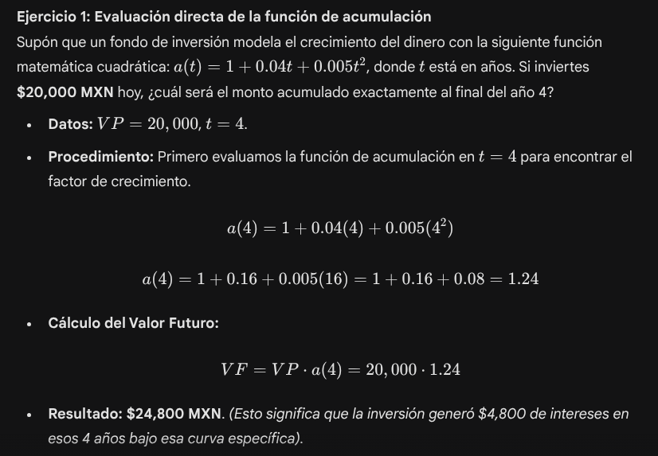

# I. Repaso de Matemáticas Financieras

# La medición del interés

## Interés y descuento

- $VP:$ Valor presente o capital inicial
- $VF:$ Valor futuro o monto
- $i:$ Tasa de interés
- $d:$  Tasa de descuento
- $t, n:$ Tiempo o número de periodos

### Interés simple

El interés se calcula únicamente sobre el capital inicial (VP). Los intereses generados en cada periodo no se reinvierten (no generan nuevos intereses). El crecimiento del dinero es lineal.

$$
VF=VP\cdot(1+it)
$$

- Donde el interés generado es $I=(1+it)$

| ***t*** | 0 | 1 | 2 | … | n |
| --- | --- | --- | --- | --- | --- |
| ***VF*** | VP | VP (1+i) | VP (1+2i) | … | VP(1+ni) |

### Interés compuesto

El interés se calcula sobre el capital inicial más los intereses acumulados de los periodos anteriores (interés sobe interés). El crecimiento del dinero es exponencial.

$$
VF=VP \cdot (1+i)^n
$$

- Para regresar al presente ($n$ periodos atrás) tenemos que $VP = VF\cdot(1+i)^{-n}$

| ***t*** | 0 | 1 | 2 | … | n |
| --- | --- | --- | --- | --- | --- |
| ***VF*** | VP | VP (1+i) | VP (1+i)^2 | … | VP(1+i)^n |

### Descuento simple

A diferencia del interés (que suma hacia el futuro desde el VP), el descuento resta hacia el presente desde el VF. El descuento solo se calcula sobre el VF.

$$
VP=VF\cdot (1-dt)
$$

- Donde el descuento aplicado es $D=(1-dt)$

| ***t*** | 0 | 1 | … | t-1 | t |
| --- | --- | --- | --- | --- | --- |
| ***VP*** | VF (1-dt) | VF (1-d(t-1)) | … | VF (1-d) | VF |

### Descuento compuesto

Es la aplicación de una tasa de descuento $d$ de forma sucesiva sobre el valor nominal VF. Cada periodo se descuenta sobre el saldo ya rebajado del periodo anterior.

$$
VP = VF \cdot (1-d)^n
$$

| ***t*** | 0 | 1 | … | t-1 | t |
| --- | --- | --- | --- | --- | --- |
| ***VP*** | VF (1-d)^t | VF (1-d)^{t-1} | … | VF (1-d) | VF |

### Interés vs Descuento

$$
i=\frac{d}{1-d} \hspace{1cm} ; \hspace{1cm} d=\frac{i}{1+i}
$$

## Tasas de interés

### Tasa nominal

Es una tasa de referencia expresada usualmente como tasa anual, que ignora el efecto del interés compuesto (capitalizaciones) dentro de ese mismo año. Una tasa nominal $i^{(m)}$ indica que se capitaliza $m$ veces al año.

Ejemplos:

- $i^{(2)}$ es la tasa nominal anual que capitaliza 2 veces al año (semestralmente)
- $i^{(4)}$ es la tasa nominal anual que capitaliza 4 veces al año (trimestralmente)
- $i^{(6)}$ es la tasa nominal anual que capitaliza 6 veces al año (semestralmente)
- $i^{(12)}$ es la tasa nominal anual que capitaliza 12 veces al año (mensualmente)
- $i^{(365)}$ es la tasa nominal anual que capitaliza dos veces al año (diariamente)

La tasa efectiva (real) $i_p$ se calcula sobre el periodo $p$ del que se esta capitalizando la tasa nominal $i^{(m)}$:

$$
i_p = \frac{i^{(m)}}{m}
$$

Ejemplos:

- Si la tasa nominal $i^{(2)}=10\%$, entonces la tasa efectiva semestral es $i_{\text{sem}}=\frac{10}{2}=5\%$
- Si la tasa nominal $i^{(3)}=18\%$, entonces la tasa efectiva cuatrimestral es $i_{\text{cuatrim}}=\frac{18}{3}=6\%$
- Si la tasa nominal $i^{(12)}=33\%$, entonces la tasa efectiva mensual es $i_{\text{mes}}=\frac{33}{12}=2.75\%$

### Tasa efectiva

Es la tasa de interés real $i$ que considera la capitalización de intereses a lo largo de un año. A diferencia de la tasa nominal, refleja el costo o rendimiento verdadero al incluir la frecuencia de reinversión. Es la base del cálculo para los diferentes tipos de interés (simple, compuesto, etc).

La conversión de la tasa efectiva y anual, se despeja de la siguiente igualdad:

$$
(1+i)=(1+\frac{i^{(m)}}{m})^m
$$

Por lo tanto, la conversión de la tasa nominal a la tasa efectiva es:

$$
i=(1+\frac{i^{(m)}}{m})^m-1
$$

### Tasas equivalentes

Dos tasas de interés son equivalentes si, a pesar de tener diferente frecuencia de capitalización, producen exactamente el mismo valor futuro al final del mismo plazo (usualmente un año). Es decir, ambas arrojan la misma tasa efectiva anual.

$$
(1+\frac{i^{(m)}}{m})^m = (1+\frac{j^{(n)}}{n})^n
$$

#### Ejercicios

1. Calcular la tasa efectiva anual de $i^{(12)}=0.36$.

$$
i=(1+\frac{i^{(12)}}{12})^{12}-1=(1+\frac{0.36}{12})^{12}-1=0.4257=42.57\%
$$

1. Calcular la tasa nominal capitalizable trimestralmente de $i=0.15$.

$$
\frac{i^{(4)}}{4}=\sqrt[4]{(1+i)}-1= \sqrt[4]{(1+0.15)}-1 = 0.0355 \\ \Longrightarrow i^{(4)}=4(0.0355)=14.22\%
$$

1. Calcular la tasa nominal capitalizable mensualmente de $i^{(2)}=0.18$.

$$
(1+\frac{i^{(m)}}{m})^m = (1+\frac{j^{(n)}}{n})^n \Longrightarrow (1+\frac{i^{(12)}}{12})^{12} = (1+\frac{0.18}{2})^2 
$$

$$
i^{(12)} = \left[\sqrt[12]{(1+\frac{0.18}{2})^2}-1 \right]12 = 17.36\%
$$

1. Inviertes 10,000 MXN a 2 años. El banco paga una tasa nominal del 12% capitalizable mensualmente. ¿Cuánto dinero tendrás al final?

Calculamos la tasa efectiva:

$$
i=(1+\frac{i^{(12)}}{12})^{12}-1=(1+\frac{0.12}{12})^{12}-1=0.1268 = 12.68\%
$$

Calculamos el valor futuro con interés compuesto:

$$
VF=VP(1+i)^n = 10,000*(1+0.1268)^2 = 12,696.78 \text{ MXN}
$$

También se puede calcular de la siguiente forma:

$$
VF=VP(1+i)^n=VP(1+ \frac{i^{(m)}}{m})^{n\cdot m} = 10,000*(1+\frac{0.12}{12})^{24} = 12,696.78 \text{}
$$

1. Se firma un pagaré por 100,000 MXN con vencimiento a 2 años. El banco lo negocia hoy aplicando una tasa de descuento compuesto del 10% anual. ¿Cuánto dinero recibe el cliente hoy?

$$
VP = VF(1-d)^{n} = 10,000(1-0.10)^{2}=81,000 \text{ MXN}
$$

## Función de acumulación y fuerza de interés

### Interés continuo

¿Qué pasa si en el interés compuesto empezamos a capitalizar cada vez más rápido? Primero mensual, luego diario, luego por hora, por minuto, por segundo, hasta que $m\to \infty$.

Este límite nos lleva al número de Euler:

$$
\lim_{m\to\infty}(1+\frac{i^{(m)}}{m})^{m\cdot t} = e^{\delta t}
$$

- Donde $\delta$ es la fuerza de interés constante a lo largo del tiempo.

Por lo tanto, el valor futuro está dado por:

$$
VF=VP\cdot e^{\delta t}
$$

Mientras que el valor presenta es:

$$
VP = VF\cdot e^{-\delta t}
$$

### Fuerza de interés

Si queremos saber qué tan rápido está creciendo nuestro dinero en un instante exacto (no en un año, ni en un mes, sino en este milisegundo), necesitamos usar el cálculo diferencial.

A esta medida de crecimiento instantáneo se le llama fuerza de interés $(\delta)$. Se define como la derivada de la función de acumulación dividida por la función misma:

$$
\delta_t = \frac{a'(t)}{a(t)}
$$

### Función de acumulación

La función de acumulación denotada como $a(t)$ define el valor acumulado en el tiempo $t$ de una inversión inicial de exactamenteuna unidad, realizada en el momento $t=0$.

Cualquier problema de valor futuro puede reescribirse usando esta función:

$$
VF = VP \cdot a(t)
$$

Donde:

- Para interés simple: $a(t)=1+it$
- Para interés compuesto: $a(t) = (1+i)^n$
- Para interés continuo: $a(t) = e^{\delta t}$

Las propiedades fundamentales de la función de acumulación son:

- $a(0)=1$
- $a(t)$ es creciente si la tasa es positiva.
- $a(t)$ generalmente es continua, útil para derivar e integrar.

### Equivalencia entre tasa efectiva y tasa continua

Para convertir una tasa efectiva en una tasa continua, como ambas deben generar el mismo dinero en un año, igualamos sus funciones de acumulación:

$$
1+i=e^{\delta} 
$$

En donde:

$$
i=e^{\delta} -1 \hspace{1cm} ; \hspace{1cm} \delta=\ln(1+i)
$$

#### Ejercicios

1. 

1. 

1. 

1. 

# Solución a problemas de interés

## Ecuación de valor y variables desconocidas

### Ecuación de valor

La ecuación de valor es la igualdad matemática que se establece entre dos conjuntos de flujos de efectivo evaluados exactamente en el mismo instante de tiempo. A ese instante específico donde "movemos" todo el dinero para poder sumarlo, restarlo o igualarlo se le conoce como Fecha Focal (FF). 

Es especialmente útil en interés compuesto ya que gracias a las propiedades de los exponentes, la elección de la FF no altera el resultado final.

$$
\sum \text{Deudas en FF} = \sum \text{Pagos en FF}
$$

### Tasa de interés desconocida

Se sabe cuento se invierte hoy (VP), también cuanto se recibe a futuro (VF) y el plazo (n), pero se necesita descubrir qué tasa de rendimiento real se está otorgando. Para interés compuesto:

$$
VF = VP\cdot (1+i)^n \quad \Longrightarrow \quad i=(\frac{VF}{VP})^{\frac{1}{n}}-1
$$

### Determinación de plazos

Se tiene VP, VF y la tasa de interés pero se necesita descubrir el número de plazos:

$$
VF = VP\cdot (1+i)^n \quad \Longrightarrow \quad n = \frac{\ln\left[\frac{VF}{VP}\right]}{\ln (1+i)}
$$

#### Ejercicios

1. Una empresa de análisis de datos debe **10,000 MXN** que vencen en el mes 3, y **15,000 MXN** que vencen en el mes 6. Acuerda con el banco liquidar ambas deudas con un solo pago exacto en el mes 6. Si la tasa de reestructuración es del **12%** nominal capitalizable mensualmente, ¿de cuánto será el pago único X?

- Tasa efectiva: $i=\frac{0.12}{12}=0.01$ mensual.
- Linea de tiempo

- Ecuación de valor con FF en $t=6$:

$$
X = 10,000 (1.01)^3 + 15,000 =  10,000 (1.0303) + 15,000 = 25,303.01

$$

1. Tienes una deuda de **50,000 MXN** a pagar exactamente en 12 meses. Quieres reestructurarla en dos pagos: un pago X el día de hoy (t=0) y un pago del doble (2X) en el mes 6. La tasa es del **18%** nominal capitalizable mensualmente. ¿De cuánto es cada pago?
- Tasa efectiva: $i = \frac{0.18}{12}=0.015$ mensual
- Ecuación de valor con FF en $t=12$:

$$
X \cdot (1.015)^{12} + 2X \cdot (1.015)^6 = 50,000
$$

$$
X \cdot (1.1956) + 2X \cdot (1.0934) = 50,000
$$

$$
1.1956X + 2.1868X = 50,000
$$

$$
3.3824X = 50,000 \quad \Longrightarrow X = \frac{50,000}{3.3824} = 29,564.80 \text{ MXN}
$$

1. Un algoritmo debe decidir qué flujo de caja es más valioso hoy ($t=0$) usando una tasa de rendimiento exigida del **8%** efectiva anual. ¿Qué tasa conviene más?
Opción A: Recibir **100,000 MXN** en el año 1 y **100,000 MXN**en el año 2.
Opción B: Recibir **210,000 MXN** en el año 2.

1. 

1. 

1. 

# Anualidades básicas

## Intuición de la suma geométrica

Si se quisiera saber el VP o VF de mútilples pagos, se podrían llevar a una fecha focal uno por uno usando las fómulas de interes o descuento compuesto modelando una ecuación de valor. Sin embargo, es costoso. Por lo que se hace uso de sumas y series.

### Suma geométrica finita

Una serie geométrica es un tipo especial de sucesión llamada progresión geométrica. Esta progresión es una sucesión en la que a partir de un término inicial $a$, los términos de la seria se obtienen multiplicando el término anterior por una constante $r$ llamada razón común.

Ejemplo: $\frac{1}{2},\frac{1}{4},\frac{1}{8},...$ , es una serie geométrica con razón $r=\frac{1}{2}$ (cada término de la serie se obtiene multiplicando el anterior por la razón $r$).

Por lo tanto, para un número finito de términos $a,ar, ar^2,..., ar^n$, la suma de todos los $n$ términos anteriores es:

$$
a+ar+ar^2+...+ar^n = \sum_{k=0}^{n}ar^k
$$

- Cuando $|r|>1$, la suma solo puede calcularse sumando todos los los términos.
- Sin embargo cuando $0<r<1$, la suma geométrica toma el siguiente valor:

$$
a+ar+ar^2+...+ar^n = a\left(\frac{1-r^{n-1}}{1-r} \right) \quad \text{con }0<|r|<1 
$$

O bien si solo queremos saber el crecimiento total de la suma respecto al término incial $a$:

$$
r^k + r^{k+1} + ... + r^{n} = \frac{r^{k}-r^{n+1}}{1-r}
$$

donde $k$ es el exponente de la razón en el primer término.

### Suma geométrica infinita

Cuando hay infinitos términos en una progresión geométrica, la serie geométrica es:

$$
a+ar+ar^2+...+ar^n = \sum_{k=0}^{\infty}ar^k
$$

El resultado de una serie infinita puede ser convergente o divergente. La convergencia significa que hay un valor después de sumar infinitos términos, mientras que la divergencia significa que no hay ningún valor después de la suma.

- Cuando $|r|>1$, la suma es divergente. No se sabe el valor.
- Cuando $|r|=1$, la suma es divergente. Todos los números de la serie son los mismos. No se sabe el valor.
- Cuando $|r|>1$, la suma es convergente al siguiente valor límite:

$$
a+ar+ar^2+... =\frac{a}{1-r}
$$

O bien si solo nos interesa el crecimiento respecto a $a$:

$$
1+r+r^2+...+r^n = \frac{1}{1-r}
$$

## Anualidades

Una anualidad es una serie de pagos iguales $R$ realizados a intervalos de tiempo regulares. Dependiendo del momento exacto en el que se hace el pago dentro del periodo, se clasifican en anticipadas y vencidas.

### Anualidad vencida u ordinaria

Los pagos se realizan **al final** de cada periodo (ej. la quincena trabajada se paga al final de la quincena; la mensualidad del crédito se paga vencido el mes).

- **Valor presente** $(a_{\overline{n}|i})$: Trae todos los pagos futuros al periodo $t=0$ (un periodo antes del primer pago):

$$
VP = R(1+i)^{-1}+R(1+i)^{-2}+...+ R(1+i)^{-n}
\\ \quad \\ = R \left[ \left(\frac{1}{1+i} \right)^1 + \left(\frac{1}{1+i} \right)^2 + ... + \left(\frac{1}{1+i} \right)^n \right]
\\ \quad \\  =R\left( v^1 + v^2 + ... + v^n \right) \quad \text{donde }v=\frac{1}{1+i}
\\ \quad \\  =R \left( \frac{v-v^{n+1}}{1-v} \right) \quad \text{aplicando suma geométrica} 
\\ \quad \\ = ... \quad \text{despejes y transformaciones} 
\\ \quad \\ = R \left( \frac{1-v^n}{i} \right)
\\ \quad \\ = R  \cdot a_{\overline{n}|i}

$$

Resumen:

$$
VP = R  \cdot a_{\overline{n}|i} =R \left[ \frac{1-v^n}{i} \right]
$$

donde:

- $v = \frac{1}{1+i}$ es el factor de descuento
- $i$ es la tasa de interés efectiva
- $n$ es el número de pagos
- **Valor futuro** $(s_{\overline{n}|i})$: Lleva todos los pagos al momento del último pago $t=n$:

$$
VF = R  \cdot s_{\overline{n}|i} =R \left[ \frac{(1+i)^n-1}{i} \right]
$$

### Anualidad anticipada

Los pagos se realizan **al principio** de cada periodo (ej. pagar la renta de un departamento por adelantado, o la prima de un seguro). Se denotan con una diéresis sobre la letra actuarial.

- **Valor presente** $(\ddot{a}_{\overline{n}|i})$: Trae todos los pagos futuros al periodo $t=0$ (periodo donde se hace el primer pago):

$$
VP = R  \cdot \ddot{a}_{\overline{n}|i} =R \left[ \frac{1-v^n}{d} \right]
$$

donde $d=\frac{i}{1+i}$ es la tasa de descuento (o factor de descuento).

- **Valor futuro** $(\ddot{s}_{\overline{n}|i})$: Lleva todos los pagos al periodo $t=n$ (un periodo después del último pago):

$$
VP = R  \cdot \ddot{a}_{\overline{n}|i} =R \left[ \frac{(1+i)^n-1}{d} \right]
$$

## Perpetuidades

Es una anualidad donde el número de pagos $n$ tiende a infinito ( $n \to \infty$ ).  Es decir, son flujos de efectivo constantes que nunca terminan.

Matemáticamente como $i>0$, entonces el factor de descuento $d=\frac{i}{1+i}<0$. Al elevar una constante menor a cero a una potencia infinita, el termino se vuelve cero, por lo que al sustituir el cero en las formulas de anualidad, y como vimos en sumas infinitas, este valor converge a un valor.

Las perpetuidades no tienen Valor Futuro, porque el infinito no tiene un periodo final. Solo se les puede calcular el Valor Presente.

### Perpetuidad vencida u ordinaria

El primer pago se recibe al final del primer periodo $t=1$, y continúan para siempre.

$$
VP = R \cdot a_{\overline{\infty}|i} = \frac{R}{i}
$$

### Perpetuidad anticipada

El primer pago se recibe hoy mismo $t=0$ , y continúan para siempre.

$$
VP = R \cdot \ddot{a}_{\overline{\infty}|i} = \frac{R}{d}
$$

#### Ejercicios

1. Compras un auto y acuerdas pagar 48 mensualidades vencidas de **5,000 MXN**. La agencia te cobra una tasa de interés nominal del **12%** capitalizable mensualmente. ¿Cuál es el valor real (de contado o Valor Presente) del automóvil que estás financiando?

1. Decides ahorrar **2,000 MXN** al final de cada mes durante 2 años exactos en un fondo de inversión que te garantiza un rendimiento del **0.5%** efectivo mensual. ¿Cuánto dinero tendrás acumulado justo después de hacer tu último depósito?

1. Rentas un local comercial por un año. El contrato estipula 12 pagos de **10,000 MXN**, pagaderos obligatoriamente a principios de cada mes (el pago 1 es hoy). Si la tasa de interés del mercado es del **1%** efectivo mensual, ¿cuánto tendrías que pagar hoy en un solo desembolso para liquidar todo el año por adelantado?

1. Este es un clásico de finanzas corporativas. Una empresa emite acciones preferentes que garantizan pagar un dividendo de **150 MXN** exactos al final de cada año, para toda la eternidad. Si los inversionistas de ese sector exigen una tasa de rendimiento efectivo anual del **8%**, ¿cuál es el precio justo o Valor Presente de esa acción hoy?

## Solución a problemas de anualidades

### Anualidades geométricas

Hasta ahora hemos asumido que la renta $R$ es constante. Una anualidad geométrica es una serie de pagos donde cada pago es mayor (o menor) que el anterior en un factor constante.

$$
VP = \frac{R}{(1+i)}+\frac{R(1+g)}{(1+i)^2}+ ... + \frac{R(1+g)^{n-1}}{(1+i)^n}
$$

Sea $g$ la tasa de crecimiento de los pagos, para calcular el Valor Presente de la anualidad existen dos escenarios posibles.

- Cuando $i\neq g$:

$$
VP=R\cdot \left[ \frac{1- \left(\frac{1+g}{1+i}\right)^n}{i-g} \right]
$$

- Cuanto $i=g$:

$$
VP = R \cdot \left[ \frac{n}{1+i} \right]
$$

### Valuación de anualidades en cualquier momento del tiempo

Las fórmulas clásicas de anualidades son muy rígidas: $a_{\overline{n}|i}$ nos situa en el periodo antes del primer pago, mientras que $s_{\overline{n}|i}$ deja en el periodo del último pago. ¿Qué pasa si se necesita calcular el valor de la anualidad en un periodo diferente?

- Paso 1: Aplicar la fórmula de VP o VF para calcular todos los flujos en un solo monto en el tiempo 0 o en el tiempo $n$.
- Paso 2: Trasladamos este capital por la linea de tiempo hasta la fecha focal deseada usando interés compuesto y la tasa efectiva correspondiente al periodo.

# Amortización

## Tablas de amortización

### Definición de Amortización

La amortización es el proceso de distribuir el costo de un activo o pasivo a lo largo del tiempo mediante pagos regulares. Es decir, se refiere a la liquidación de un préstamo a través de cuotas que cubren tanto el capital como los intereses.

Cada vez que se hace un pago $R$, el banco lo divide en dos partes:

$$
R=I+A
$$

donde:

- $I$ es el interés. Es el costo del dinero. Se calcula sobre lo que se debía antes de hacer el pago. El banco cobra esto primero.
- $A$ es la amortización de capital. Es lo que sobra del pago después de cubrir los interes. Esta es la parte que realmente reduce la deuda.

Al principio del préstamo, gran parte del pago se va a intereses. Al final, casi todo el pago se va al capital.

### Estructura y variables de la Tabla de Amortización

Una tabla de amortización es un cuadro que detalla, periodo a periodo, cómo un pago constante se divide para cubrir los intereses generados y reducir el capital adeudado, hasta que la deuda llega a cero.

Regularmente la tabla tiene las siguientes columnas:

- Periodo ($t$): El número de pago o momento en el tiempo. Inicia en 0.
- Pago ($R$): La mensualidad fija (o variable) que se paga. Se calcula previamente con fórmulas de anualidades.
- Interés ($I_t$): Se calcula como $I_t=i\cdot B_{t-1}$
- Amortización ($A$): Se calcula como $A_t = R_t - I_t$
- Saldo Insoluto ($B$): La deuda restante. Se calcula como $B_t = B_{t-1} - A_t$

Notemos que:

- **Los intereses son decrecientes:** Como cada mes debes menos capital, el interés que se genera sobre ese capital es cada vez menor. Al principio del crédito, casi todo tu pago se va a intereses.
- **La amortización es creciente:** Dado que el pago $(R)$ es fijo y el interés $(R)$ disminuye, cada mes sobra más dinero de tu pago para "matar" el capital. En las últimas cuotas, casi todo el pago se va directo a reducir la deuda.
    
    
    Ejemplo: Sea $i=5\%$
    

| Periodo (t) | Pago (R) | Interés (I) | Amortización (A) | Saldo Insoluto (B) |
| --- | --- | --- | --- | --- |
| 0 | - | - | - | $ 5,000.00 |
| 1 | $ 1,410.06 | $ 250.00 | $ 1,160.06 | $ 3,839.94 |
| 2 | $ 1,410.06 | $ 192.00 | $ 1,218.06 | $ 2,621.88 |
| 3 | $ 1,410.06 | $ 131.09 | $ 1,278.97 | $ 1,342.91 |
| 4 | $ 1,410.06 | $ 67.15 | $ 1,342.91 | $ 0.00 |
| Totales | $ 5,640.24 | $ 640.24 | $ 5,000.00 | - |

### Método Retrospectivo para Saldo Insoluto

Este método calcula la deuda pendiente mirando el "pasado" de la operación financiera. Es útil cuando se quiere encontrar cuanto se debe sin construir la tabla de amortización.

Para encontrar el saldo insoluto ($B_k$) en el periodo $k$:

$$
B_k = VP(1+i)^k - R\cdot s_{\overline{k}|i}
$$

donde:

- $VP(1+i)^k$ es el préstamo original llevado al futuro hasta la fecha $k$
- $R\cdot s_{\overline{k}|i}$ es el valor futuro de la anualidad de los apgos que ya realizamos (de 1 hasta $k$)

Ejemplo: Del mismo ejercicio anterior, calcular el saldo después del pago 2 (k=2).

$$
B_k = 5,000(1.05)^2 - 1,410.06\cdot s_{\overline{2}|0.05} \\
B_k = 5,512.50-1,410.06\left[ \frac{(1.05)^2-1}{0.05} \right] \\
B_k = 5,512.50-2,890.62 = 2,621.88
$$

### Método Prospectivo para Saldo Insoluto

Este método es el más rápido y usado. Calcula la deuda pendiente mirando el “futuro”.

Para encontrar el saldo insoluto ($B_k$) en el periodo $k$:

$$
B_k = R\cdot C_{n-k|i}
$$

donde:

- $n-k$ es el número de los pagos pendientes.
- $C_{n-k|i}$ es el valor presente para estos pagos restantes.

Ejemplo: Del mismo ejercicio anterior, calcular el saldo después del pago 2 (k=2).

$$
B_k = 1,410.06\left[ \frac{1-(1.05)^{4-2}}{0.05} \right]=1,410.06(1.85941) = 2,621.88
$$

### Fondos de amortización

Mientras que la amortización de deuda busca que el saldo llegue a cero (extinguir un pasivo), el fondo de amortización busca que el saldo llegue a un monto objetivo (acumular un activo).

Es una cuenta de ahorro especial donde se depositan cantidades periódicas que ganan interés, con el fin de reunir una suma específica en el futuro.

Aqui usamos la fórmula de valor futuro $VF$ de la anualidad ordinaria:

$$
VF = R\cdot s_{\overline{n}|i} = R \left[ \frac{(1+i)^{n}-1}{i}\right]
$$

La tabla de fondo, cambia ligeramente respecto a la de deuda:

- Periodo ($t$): Número de depósito
- Déposito ($R$): Aportación fija
- Interés Ganado ($I_t$): Es el remdimiento que genera el dinero que ya teniamos acumulado. Se calcula como $I_t= i \cdot S_{t-1}$
- Aumento al fondo ($A_t$): Es el dinero nuevo entra a la cuenta en el periodo $t$. Se calcula como $A_t=R + I_t$
- Saldo Acumulado $(S_t)$: Es el total de dinero que se tiene disponible en el fondo hasta ese momento. Se calcula como $S_t = S_{t-1} + A_t$

Ejemplo: Una fábrica sabe que su máquina principal dejará de servir en 3 meses y necesirará $10,000 para comprar la nueva. Decide abrir un fondo que paga el 2% mensual. ¿Cuánto debe depositar cada mes y cómo crece el fondo?

- Calculculamos el déposito mensual $R$:

$$
VF = R\cdot s_{\overline{n}|i} \\ \quad \\
\Rightarrow R =\frac{VF}{s_{\overline{n}|i}} =\frac{VF}{s_{\overline{3}|0.02}} = \frac{10,000}{\left[ \frac{(1+0.02)^3-1}{0.02} \right]} =\frac{10,000}{3.0604}=3,267.54
$$

- Construcción de la tabla (fila por fila):

| Periodo (t) | Depósito (R) | Interés Ganado (I) | Aumento fondo (A) | Saldo Acum (S) |
| --- | --- | --- | --- | --- |
| 1 | $ 3,267.54 | $ 0.00 | $ 3,267.54 | $ 3,267.54 |
| 2 | $ 3,267.54 | $ 65.35 | $ 3,332.89 | $ 6,600.43 |
| 3 | $ 3,267.54 | $ 132.01 | $ 3,399.55 | $ 10,000.00 |
| Totales | $9,802.62 | $ 197.36 | $ 10,000.00 | - |
