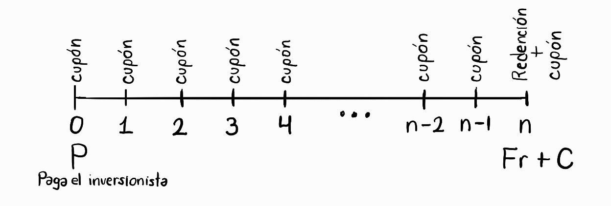

# III y IV. Bonos

# Definición de bono

Un bono es un instrumento financiero donde el emisor se compomete a devolver el capital prestado al inversor mediante rentas periódicas (intereses) llamadas cupones, más un pago final llamado de redención dentro de un determinado plazo. Es emitido en el mercado primario, con el objetivo de obtener financiamiento.

### Valor nominal y valor de redención

- Valor nominal o facial $(F)$: Es el valor de referencia del bono. Su función principal es servir como base de cálculo para calcular el monto de los intereses/cupones.
- Valor de redención $(C)$: Es la cantidad exacta de dinero que el emisor devolverá el día de vencimiento del bono.
    
    Generalmente el bono se redime “a la par”, es decir, el emisor devuelve exactamente lo que dice el papel $(C=F)$, aunque existen bonos que redimen con una prima $(C>F)$.
    

### Tasa cupón vs Tasa de rendimiento o de mercado

- Tasa cupón $(r)$: Es la tasa de interés que viene impresa en el documento del bono. **Es fija y nunca cambia**. Su única utilidad es multiplicarla por el valor nominal $F$ para descubrir cual es el monto de los pagos periódicos o cupones.
    
    El valor del cupón es: $\text{Cupón} = F \cdot r$
    
- Tasa de rendimiento o de mercado $(i)$: Es la tasa que los inverionistas exigen para prestar su dinero, basándose en la inflación y el riesgo. **Esta tasa es variante**. Se usa en el cálculo de VP para descontar los flujos futuros del bono.

### Plazo de vencimiento y precio

- Plazo $(n)$: Es el número de periodos desde la valuación (compra/venta) del bono, hasta la fecha en la que se devuelve en valor de redención $C$. Estos periodos son la frecuencia en la que se pagan los cupones. Las tasas $r$ y $i$ también deben ser expresadas en dicha frecuencia.
- Precio $(P)$: Es el valor presente de todos los flujos.
    - Se usa $F$ y $r$ para calcular el monto de los cupones la serie de pagos futuros (anualidad)
    - Se usa $C$ para saber el monto del pago final.
    - Se usa $i$ para traer todo todo el dinero al momento 0.

### Ecuación fundamental de valuación

El precio justo o teórico de un bono $(P)$ en el momento de su emisión (o en cualquier fecha de pago de cupón) se construye sumando sus dos componentes:

1. El **valor presente de los cupones**: El emisor pagará una periódicamente el valor de los cupones, por lo que para calcular el valor presente con tasa de mercado $i$, y con $n$ periodos, usamos la definición de cupón y de anualidad vencida $(a_{\overline{n}|i})$:

$$
VP_{\text{cupones}}=(F\cdot r) \cdot a_{\overline{n}|i}=(F\cdot r)\cdot \left[ \frac{1-(1+i)^{-n}}{i} \right]
$$

1. El **valor presente del valor de redención**: Al final del plazo $n$, el emisor devolerá el capital de redención acordado $C$. Como es un pago futuro, lo traemos al presente usando interés compuesto y la tasa de mercado $i$:

$$
VP_{\text{redención}} = C \cdot (1+i)^{-n}
$$

Al sumar ambos componentes, obtenemos la ecuación fundamental de la valuación de bonos:

$$
P = (F\cdot r)\cdot \left[ \frac{1-(1+i)^{-n}}{i} \right] + C \cdot (1+i)^{-n}
$$

donde:

- $P:$ precio del bono hoy
- $C:$ valor de redención
- $F:$ valor nominal/facial/par
- $r:$ tasa cupón
- $i:$ tasa de rendimiento o mercado por periodo
- $n:$ número total de periodos (cupones) restantes

Como la gran mayoría de **bonos se redimen “a la par”** $(C=F)$, la fórmula se puede factorizar:

#### Ejercicios

1. Una empresa emite bonos con un valor nominal de **1,000 MXN**. El contrato establece que pagarán una tasa cupón del **8%** anual durante **5 años**. Al final del plazo, el bono se redime a la par. Si la tasa de rendimiento que exige el mercado hoy es del **10%** efectivo anual, ¿cuál es el precio justo de este bono?
- Buscamos el precio $P$ del bono. Identificamos las variables:
    - $F=1000$ MXN
    
    $$
    P = F\cdot \left( r \cdot a_{\overline{n}|i} + (1+i)^{-n} \right)
    $$
    
    - $r = 8\%$ efectiva anual
    - $n=5$ años
    - $C=F=1000$ MXN (porque se redime a la par)
    - $i=10\%$ efectiva anual
- Calculamos el precio del cupón:

$$
P=(F\cdot r)\cdot \left[ \frac{1-(1+i)^{-n}}{i} \right] + C \cdot (1+i)^{-n} \\ \quad \\
=(1,000\cdot 0.08)\cdot \left[ \frac{1-(1+0.1)^{-5}}{0.1} \right] + 1,000 \cdot (1+0.1)^{-5} \\ \quad \\
P = 303.26 + 620.92 = 924.18 \text{ MXN}
$$

- *Observación*: El bono se vende más barato que sus 1000 MXN de su valor nominal. ¿Por qué? Porque el bono paga un 8%, pero el mercado exige un 10%. Para compensar esa diferencia, el precio del bono tiene que bajar.

1. El gobierno emite bonos a **3 años** con un valor nominal de **100 MXN**. La tasa cupón es del **12%** nominal anual, pagadera en cupones semestrales. Se redime a la par. Si el mercado exige hoy una tasa de rendimiento del **10%** nominal anual capitalizable semestralmente, ¿cuál es su precio?
- Buscamos el precio $P$ del bono. Identificamos las variables:
    - $F=100$ MXN
    - $r^{(2)}= 12\%$ tasa nominal anual pagadera semestral, entonces 
    $\frac{r^{(2)}}{2}=\frac{0.12}{2}=0.06 = 6\%$ es la tasa cupón efectiva semestral
    - $n=$ 3 años * (2 semestres / año) = 6 semestres
    - $C=F=100$ MXN (porque se redime a la par)
    - $i^{(2)}=10\%$ tasa nominal anual capitalizable semestralmente, entonces
    $\frac{i^{(2)}}{2}=\frac{0.1}{2}=0.05 = 5\%$ es la tasa de mercado efectiva semestral
- Calculamos el precio del cupón. Esta vez usaremos la fórmula factorizada:

$$
P = F\cdot \left( r \cdot a_{\overline{n}|i} + (1+i)^{-n} \right) \\ \quad \\
= 100\cdot \left( 0.06 \cdot \left[ \frac{1-(1+0.05)^{-6}}{0.05} \right] + (1+0.05)^{-6} \right) \\ \quad \\
= 105.07 \text{ MXN}
$$

- *Observación*: Aquí ocurre lo contrario. El bono es tan atractivo (paga el 12% cuando el mercado solo pide el 10%) que los inversionistas están dispuestos a pagar más de sus 100 de valor nominal para tenerlo.

# Bonos según su precio de emisión

Una forma de clasificar a los bonos al momento de su valuación es la relación que tiene entre lo que el bono ofrece (tasa cupón $r$) y lo que el mercado exige (tasa de rendimiento o mercado $i$).

Asumiendo que el bono se redime a la par $(C=F)$, tenemos tres escenarios. Para ejemplificar usaremos el siguiente ejemplo para nuestro bono base:

- Valor nominal y redención: $F=C=1000$ MXN.
- Plazo: $n=3$ años
- Tasa cupón: $r = 10\%$ anual (fijo)
- Por lo tanto, el valor del cupón periódico es de $F*r = 1000*0.1=100$ MXN

### Bonos a la par

- Condición: $r = i$
- Consecuencia en el precio del bono: $P=F$

Ocurre cuando la tasa que paga el bono es **exactamente igual** a la tasa que exige el mercado en ese momento $(r=i)$. Como el contrato ofrece exactamente lo justo, el precio del bono será matemáticamente idéntico a su valor nominal $(P=F)$.

Ejemplo en el bono base:

- El mercado exige $i=10\%$, por lo que el precio del bono se valúa a:

$$
P = 100 \cdot \left[ \frac{1 - (1.10)^{-3}}{0.10} \right] + 1,000 \cdot (1.10)^{-3} = 1,000 \text{ MXN}
$$

### Bonos con prima o premio

- Condición: $r>i$
- Consecuencia en el precio del bono: $P>F$

Ocurre cuando el bono paga más de lo que el mercado exige hoy $(r>i)$. El bono se vuelve un instrumento muy atractivo. Los inversionistas se pelean por él y están dispuestos a pagar un "sobreprecio" por encima de su valor nominal para poder gozar de sus cupones altos $(P>F)$.

Ejemplo en el bono base:

- La economía mejora, las tasas mejoran, el mercado solo exige $i=8\%$, por lo que el precio del bono se valúa a:

$$
P = 100 \cdot \left[ \frac{1 - (1.08)^{-3}}{0.08} \right] + 1,000 \cdot (1.08)^{-3} = 1,051.54 \text{ MXN}
$$

*Interpretación*: Se está pagando 51.54 extra hoy, pero se recuperará con creces al recibir cupones del 10% cuando el resto del mercado apenas ofrece el 8%.

### Bonos con descuento

- Condición: $r<i$
- Consecuencia en el precio del bono: $P<F$

Ocurre cuando el bono paga menos de lo que el mercado está exigiendo hoy $(r<i)$. Como el bono es "poco atractivo" frente a otras opciones, los inversionistas castigan su precio. Se vende más barato que su valor nominal $(P<F)$ para que esa diferencia compense la falta de rendimiento en los cupones.

Ejemplo en el bono base:

- Hay inflación, el mercado ahora exige $i=12\%$, por lo que el precio del bono se valúa a:

$$
P = 100 \cdot \left[ \frac{1 - (1.12)^{-3}}{0.12} \right] + 1,000 \cdot (1.12)^{-3} = 951.96 \text{ MXN}
$$

*Interpretación*: Se compra algo de 1,000 por solo 951.96. Esa diferencia a favor es la ganancia extra de capital que compensa el hecho de recibir cupones "bajos" del 10% en un mundo que pide el 12%.

# Bonos cupón cero

### Mecánica del cupón cero

Como su nombre lo indica, un bono cupón cero tiene una tasa cupón exactamente igual a cero $(r=0)$. Esto significa que el emisor no pagará ninguna renta periódica durante la vida del instrumento.

¿Por qué alguien compraría un bono que no paga intereses? Porque estos bonos **siempre se venden con un profundo descuento** respecto a su valor nominal. La ganancia (el rendimiento) es la diferencia directa entre lo que se paga hoy por él y el valor de redención que es devuelto al final.

El ejemplo perfecto de este instrumento en el mercado mexicano son los **CETES** (Certificados de la Tesorería de la Federación). Se compra hoy a un precio menor a 10 pesos, no pagan intereses periódicos, pero en la fecha de vencimiento el gobierno paga exactamente los 10 pesos íntegros.

### Ecuación para cupón cero

Si tomamos nuestra Ecuación Fundamental de Valuación y establecemos que la tasa cupón sea $r=0$, la fórmula resultante es:

$$
P = (F \cdot 0) \cdot \left[ \frac{1 - (1+i)^{-n}}{i} \right] + C \cdot (1+i)^{-n} \\ \quad \\
= C \cdot (1+i)^{-n}
$$

# Objetivos y clasificaciones de los bonos

Hasta ahora hemos tratado a los bonos puramente como ecuaciones matemáticas, pero en los mercados financieros, estos instrumentos son contratos legales que tienen propósitos muy específicos y diferentes niveles de seguridad.

Desde la perspectiva del emisor (gobiernos o corporativos), el objetivo de emitir un bono es recibir financiación sin tener que diluir la propiedad de la empresa (como pasaría si emitieran acciones) y a un costo generalmente menor que el de un préstamo bancario tradicional. Para los inversionistas, el objetivo es obtener un flujo de ingresos constante con una fecha de retorno de capital garantizada por contrato.

### Por el número de pagos de intereses

Esta clasificación define la estructura de los flujos de efectivo en el tiempo.

- **Bonos con cupones (Pagos periódicos):** Son los bonos tradicionales. El emisor realiza pagos de intereses regulares (cupones anuales, semestrales, trimestrales) calculados sobre el valor nominal usando la tasa cupón $r$. Al final, paga el monto de redención.
    - Ejemplo: Bonos M
- **Bonos cupón cero (Un solo pago)**: No hay pagos intermedios $(r=0)$. El único flujo de efectivo ocurre al vencimiento, donde el inversionista recibe el valor de redención $C$. Su rendimiento proviene de comprarlo a descuento.
    - Ejemplo: CETES

### Por el tipo de garantía que poseen

Si la empresa quiebra, ¿qué respalda la inversión? Esta clasificación define las formas de cobrar en caso de incumplimiento del emisor (como bancarrota):

- **Garantía Quirografaria** (Sin garantía específica): No están respaldados por ningún activo físico en particular. Su única garantía es “la palabra”, la firma y la solvencia general de la entidad que lo emite. En caso de incumplimiento, el inversionista se convierte en acreedor.
- **Garantía Hipotecaria**: Están respaldados por bienes raíces o activos físicos específicos de la empresa (terrenos, fábricas, edificios). Si el emisor no paga, los dueños tinen el derecho legal de embargar y vender esos activos para recuperar su inversión.
- **Garantía Prendaria o Colateral**: Están respaldados por otros instrumentos financieros que el emisor tiene en su posesión.

### Por su grado de riesgo

El riesgo de un bono se refiere a la probabilidad de que el emisor no pueda pagar. Agencias internaciones como Standard & Poor’s, Moody’s y Fitch se dedican a calificar el de riesgo crediticio de países y empresas para pagar sus deudas.

- **Bonos con grado de inversión**: Son emitidos por empresas o gobiernos financieramente sólidos y estables. Sus calificaciones van desde AAA (máxima seguridad) hasta BBB. Como el riesgo es muy bajo, generalmente la tasa de rendimiento $i$ que ofrecen también es muy baja.
- **Bonos de grado especulativo**: Tienen calificaciones iguales o inferiores a BB+. Son emitidos por entidades altamente endeudadas, inestables o startups de alto riesgo. Para convencer a los inversionistas de asumir ese enorme riesgo, estos bonos ofrecen tasas de rendimiento $i$altas.

### Por la relación entre su valor nominal y su valor de redención

Aunque la gran mayoria de bono se redimen a la par $(C=F)$, existen contratos que pueden estipular variaciones para el pago final al vencimiento:

- **Redimibles a la par $(C=F)$**: El caso estándar. Si el valor nominal es de 1000, al final del plazo se pagan exactamente 1000.
- **Redimibles con premio o prima $(C>F)$**: Como incentivo para que los inversionistas compren la deuda, el emisor se compomete a devolver una cantidad mayor al valor nominal. Por ejemplo, se pagan cupones sobre un nominal de 1000, pero al vencimiento se devuelven 1050.
- **Redimibles con descuento** $(C<F)$: Es un caso muy raro donde el emisor devuelve menos del valor estípulado en el documento original (generalmente producto de reestructuración forzosa por quiebra).

# Valuación de bonos

Hasta ahora, nuestros modelos asumían condiciones ideales: comprar el bono el mismo día que se emitía y uso de la fórmula general.

Pero en la vida real, los inversionistas compran y venden bonos todos los días. Para ello, necesitamos herramientas matemáticas más precisas que aíslen exactamente cuánto dinero extra estamos pagando por un bono atractivo, o cómo repartir justamente un cupón cuando compras un bono a la mitad de su vida.

### Valuación de bonos con premio y con descuento

Ya sabemos qué es un bono con premio $(P>C)$ o con descuento $P<C)$. Sin embargo, existe una ecuación alternativa a la fundamental que nos permite calcular directamente el valor de ese premio o descuento sin tener que calcular el precio total primero.

Esta fórmula se conoce como la **fórmula del premio/descuento**:

$$
P = C+(F\cdot r - C\cdot i) \cdot a_{\overline{n}|i}
$$

El término $(F\cdot r - C\cdot i)$ compara dos cantidades de dinero:

- $F\cdot r$ es el dinero que se paga el cupón
- $C\cdot i$ es el dinero que el mercado exigiría recibir sobre ese capital con la tasa actual

La interpretación para esta diferencia es $(F\cdot r - C\cdot i)$:

- Si el término es positivo, el bono paga más de lo exigido. Esa diferencia, multiplicada por la anualidad es exactamente el premio $(P-C)$.
- Si el término es negativo, el bono paga menos de lo exigido. Esa diferencia, multiplicada por la anualidad es exactamente el descuento $(C-P)$.

Ejercicio: 

Un bono corporativo a 5 años tiene un valor nominal y de redención de **1,000 MXN**. Paga una tasa cupón del **10%** anual. Si la tasa de mercado baja al **7%** anual, ¿de cuánto es el premio exacto que pagarás por él?

- Identificamos las variables:
    - $F=C=1000$ MXN
    - $r= 10\%$ tasa efectiva anual
    - $n=$ 5 años
    - $i=7\%$ tasa efectiva anual
- Aplicamos la fórmula de premio

$$
P = C+(F\cdot r - C\cdot i) \cdot a_{\overline{n}|i} \\ \quad \\
= 1000 + (1000\cdot0.1 - 1000\cdot 0.07) \cdot \left[ \frac{1-(1+0.07)^{-5}}{0.07} \right] \\ \quad \\
= 1,000 + 30 \cdot (4.10020) = 123 \text{ MXN}
$$

- *Interpretación*: El premio exacto es de 123 MXN. Por lo que el precio del bono es de $1,123 MXN.

### Valuación de bonos entre dos fechas de pago de cupones

Este escenario es común del mercado secundario.

Supongamos que un inversionista A posee un bono que paga su cupón el 1 de enero. Si un inversionista B le compra a A este bono el 1 de mayo, A fue dueño del bono durante 4 meses y B lo será los 8 meses restantes. Cuando el emisor pague el cupón, se le depositará todo a B. Para ser justos, el 1 de mayo el inversionista B deberá pagar a A el precio del bono más la fracción del cupón que el ya se ganó por haber esperado 4 meses.

Se introducen los siguientes conceptos:

- **Precio sucio (flat price)**: Es el precio del bono en el momento exacto de su valuación, movido una fracción de periodo $k$ del pago entre cupones. Este es el precio que paga el comprador por el bono. Se calcula tomando el precio que tenía el bono en el último pago de cupón $(P_0)$ y capitalizándolo por la fracción de tiempo transcurrido $(k)$:

$$
P_\text{sucio} = P_0 \cdot (1+i)^k
$$

- **Interés acumulado $(I_\text{acum})$**: Es la fracción del cupón que le corresponde al vendedor por la fracción del periodo que lo tuvo en posesión.

$$
I_{acum} = k \cdot (F\cdot r)
$$

- **Precio limpio (market price)**: Es el valor real del bono libre de la “basura” del interés acumulado que le pertenece al vendedor. Es el precio que realmente cotiza en las pantallas de la bolsa de valores, separando el valor intrínseco del bono de los intereses devengados (generados pero no cobrados) del vendedor.

$$
P_\text{limpio} = P_\text{sucio} - I_{acum}
$$

Ejercicio:

Se tiene un bono de valor nominal **1,000 MXN** que paga cupones **anuales** del **10%** $(r=0.10)$. Justo después de pagar su cupón (quedándole **3 años** exactos para vencer), su precio calculado al **12%** de mercado $(i=0.12)$ era de **951.96 MXN** (este es el $P_0$ ).

Si se decide vender el bono exactamente **6 meses** después de ese último pago de cupón (es decir, $k=0.5$ de un año), ¿cuánto debe pagar el comprador en total (Precio Sucio) y cuál es el Precio Limpio cotizado?

- Precio del cupón: $(F\cdot r) = 1000 \cdot 0.10 = 100$
- Calculamos el precio sucio (lo que el comprador paga):

$$
P_\text{sucio} = P_0\cdot (1+i)^k \\ 
= 951.96 \cdot (1+0.12)^{0.5}=951.96 \cdot 1.05830 =1007.46
$$

- Calculamos el precio acumulado (lo que le corresponde al vendedor por el medio año):

$$
I_{acum} = k \cdot (F\cdot r) = 0.5 \cdot 100 = 50
$$

- Calculamos el precio limpio (el valor real sin intereses):

$$
P_\text{limpio} = P_\text{sucio} - I_{acum} = 1007.46-50=957.46
$$

- *Interpretación*: En la bolsa, se verá cotizado este bono a 957.46. Pero al momento de hacer la transacción legal, el contrato obliga al comprador a sumarle los 50.00 de interés acumulado, resultando en un pago final de 1,007.46.

### Determinación de tasas de rendimiento de un bono

La tasa de rendimiento al vencimiento (YTM - *Yield to Maturity*) es la tasa de interés interna $i$ que "iguala" el precio actual del bono con el valor presente de todos sus flujos de efectivo futuros.

Si retomamos la Ecuación Fundamental, pero desconocemos $i$:

$$
P = F \cdot r \cdot \left[ \frac{1 - (1+i)^{-n}}{i} \right] + C \cdot (1+i)^{-n}
$$

Notemos que la ecuación es un polinomio de grado $n$. No existe formula algebraica general para despejar las raíces de estos polinomios, entonces no se puede despejar $i$ directamente. Es necesario usar métodos númericos.

Para demostrar los métodos, usamos un caso dell que ya conocemos la respuesta:

- $F=1000$ MXN
- $r = 8\%$ efectiva anual
- $n=5$ años
- $C=F=1000$ MXN
- $P=924.18$
- $i=10\%$ efectiva anual (es el valor que buscaremos)

#### Interpolación Lineal

Consiste en "adivinar" dos tasas de interés ($i_1$ e $i_2$) que encajonen nuestro precio objetivo $P=924.18$ , calcular sus precios respectivos ($P_1$ y $P_2$), y trazar una línea recta entre ellos para estimar la tasa real.

1. Proponer tasas y calcular precios
    - Intento 1: $i_1=0.09$. Si calculamos el precio con esta tasa obtenemos un precio $P_1 = 961.10$.
    - Intento 1: $i_2=0.11$. Si calculamos el precio con esta tasa obtenemos un precio $P_1 = 889.12$.
    - El precio objetivo es 924.18, que está perfectamente atrapado entre estas dos tasas.
2. Aplicamos la fórmulla de interpolación:

La fórmula es:

$$
i \approx i_1 + \frac{(P - P_1) \cdot (i_2 - i_1)}{P_2 - P_1}
$$

Por lo que sustituyendo:

$$
i \approx 0.09 + \frac{(924.18 - 961.10) \cdot (0.11 - 0.09)}{889.12 - 961.10} \\ \quad \\
\approx 0.09 + \frac{(-36.92) \cdot (0.02)}{-71.98} \\ \quad \\
\approx 0.09 + \frac{-0.7384}{-71.98} \\ \quad \\
\approx 0.09 + 0.010258 = \mathbf{0.10025}
$$

- *Análisis de error*: El método asume que la curva de precios es una recta, pero en realidad es convexa. Por eso nuestro resultado (10.02%) tiene un ligero margen de error frente a la respuesta matemáticamente perfecta (10.00%).

#### Algoritmo de Newton-Raphson

### Valuación de bonos liquidables antes de su fecha de vencimiento

¿Qué pasa si el contrato le da al emisor el derecho de "arrepentirse" y devolverte tu dinero antes de tiempo?

Valuar este bono es sencillo conociendo la Ecuación Fundamental. Si el bono se liquida en el periodo $t$ (donde $t<n$), simplemente sustituimos el plazo original $n$ por el plazo de redención $t$, y sustituimos el valor de redención original $C$ por el precio de redención anticipada $C_t$.

$$
P = F \cdot r \cdot a_{\overline{t}|i} + C_t \cdot (1+i)^{-t} \\ \quad \\
P = F \cdot r \cdot \left[ \frac{1 - (1+i)^{-t}}{i} \right] + C_t \cdot (1+i)^{-t}
$$

# [C] Fórmulas para el cálculo de bonos

A continuación se presentan cuatro fórmulas para calcular el precio $P$ del bono, ofreciendo cada una distinta perspectiva e interpretación financiera a los términos.

Recordaemos que el factor de descuento $v$ está definido como:

$$
v = \frac{1}{1+i} \quad \text{por lo tanto} \quad v^n = (1+i)^{-n}
$$

### Fórmula básica (Ecuación fundamental)

$$
P =(F\cdot r)\cdot a_{\overline{n}|i} + C \cdot v^{n} \\ \quad \\
= (F\cdot r)\cdot \left[ \frac{1-v^{n}}{i} \right] + C \cdot v^{n}
$$

### Fórmula de premio y descuento

$$
P = C+(F\cdot r - C\cdot i) \cdot a_{\overline{n}|i} \\ \quad \\
 = C+(F\cdot r - C\cdot i) \cdot \left[ \frac{1-v^{n}}{i} \right]
$$

### Fórmula de Makeham

Su perspectiva radica en expresar el precio del bono basándose únicamente en el valor de redención descontado.

$$
P = K + \frac{g}{i}(C - K)
$$

donde:

- $K = C\cdot v^n$  es el valor presente de la redención.
- $g = \frac{F\cdot r}{C}$ es la tasa cupón modificada. Representa el porcentaje del valor del cupón respecto al valor de redención.

### Fórmula del Monto Base (Base Amount)

En lugar de enfocarse en la redención, se enfoca en la perpetuidad de los cupones.

$$
P = G + (C - G) \cdot v^n
$$

donde:

- $G=\frac{F\cdot r}{i}$ es el monto base.

# [C] Métodos para la valuación de bonos entre dos fechas de pago

### Método Teórico

**Flat price** 
(Precio sucio)

$$
P_\text{flat}=B_t \cdot (1+i)^k
$$

**Accrued Coupon / Interest** 
Interés / cupón devengado o acumulado

$$
I_\text{accrued}=F \cdot r \cdot \left( \frac{(1+i)^k - 1}{i} \right)
$$

**Market price** 
(Precio limpio)

$$
P_\text{market} = P_\text{flat} - I_\text{accrued}\\ \quad \\
= B_t \cdot (1+i)^k
- F \cdot r \cdot \left( \frac{(1+i)^k - 1}{i} \right)
$$

Asume que el dinero genera interés compuesto en todo momento, sin importar si es un año completo o la fracción de un día ($k$). Todo, tanto el precio total como el cupón devengado, crece de manera exponencial.

El termino del interés devengado  $\left( \frac{(1+i)^k - 1}{i} \right)$ calcula el valor exacto de un cupón que se está "acumulando" continuamente a interés compuesto durante esa fracción de tiempo.

Es el estándar en las ciencias actuaríales puras. Se utiliza en modelos cuantitativos avanzados (como valuación de opciones sobre bonos).

### Método Práctico

**Flat price** 

$$
P_\text{flat}=B_t \cdot (1+ik)
$$

**Accrued Coupon / Interest** 

$$
I_\text{accrued}= k \cdot F \cdot r
$$

**Market price** 

$$
P_\text{market} = P_\text{flat} - I_\text{accrued}\\ \quad \\
= B_t \cdot (1+ik)
- k \cdot F \cdot r
$$

Utiliza interés simple para cualquier fracción de tiempo. El crecimiento del precio y el cupón entre los días de pago es lineal.

Hoy en día, su uso está restringido al **mercado de dinero** (instrumentos con vencimiento menor a un año), donde la diferencia matemática entre el interés simple y el compuesto es relativamente muy pequeña.

### Método Semi-Teórico / Semi-Práctico

**Flat price** 

$$
P_\text{flat}= B_t \cdot (1+i)^k
$$

**Accrued Coupon / Interest** 

$$
I_\text{accrued}= k \cdot F \cdot r
$$

**Market price** 

$$
P_\text{market} = P_\text{flat} - I_\text{accrued}\\ \quad \\
= B_t \cdot (1+i)^k
- k \cdot F \cdot r
$$

Es el método hibrido donde se calcula el precio sucio con el rigor matemático del interés compuesto, pero se calcula el interés acumulado con interés simple.

Es la convención estándar en la mayoría de los mercados de bonos del mundo.

### Tabla comparativa

# Tabla de amortización para bonos

### Variables y estructura de la tabla

A diferencia de la amortización de un préstamo normal (donde el pago es para matar la deuda), aquí se evaluá el dinero que se recibe (el cupón) y se compara contra el interés que se debería estar ganando según el mercado. Las columnas son:

- **Periodo** $(t)$: Momento del pago del cupón.
- **Cupón cobrado** $(F\cdot r)$: El dinero que se esta cobrándo. Es constante en todos los periodos.
- **Interés efectivo** $(I_t)$: Es el rendimiento que generó la inversión en ese periodo. Se calcula con:

$$
I_t = B_{t-1} \cdot i
$$

- **Premio/Descuento** $(A_t)$: Es la diferencia absoluta entre lo que se recibe (cupón) y el rendimiento generado $(I_t)$. Esta cantidad es la que ajusta el valor del bono:

$$
A_t = |(F\cdot r) - I_t |
$$

- **Precio o valor en libros** $(P_t)$: Es el precio del bono en ese instante:

Si es un **bono con premio, el precio baja**:

$$
B_t = B_{t-1}-A_{t}
$$

Si es un **bono con descuento, el precio sube**:

$$
B_t = B_{t-1}+A_{t}
$$

Ejercicio:

- Valor nominal y redención: $F = C = 1000$ (redimen a la par)
- Plazo: $n=3$ años
- Tasa cupón: $r=10\%$
- Valor del cupón: $F\cdot r = 1000 \cdot 10\% = 100$
- Tasa de mercado: $i = 8\%$

Calculando el precio del bono hoy (periodo 0) es $P = 1,061.54$

| Año (t) | Cupón (F*r) | Interés (I) | Premio/Descuento | Precio (P) |
| --- | --- | --- | --- | --- |
| 0 |  |  |  | $ 1,051.54 |
| 1 | $ 100.00 | $ 84.12 | $ 15.88 | $1,035.66 |
| 2 | $ 100.00 | $ 82.85 | $ 17.15 | $ 1,018.51 |
| 3 | $ 100.00 | $ 81.48 | $ 18.52 | **$ 1,000.00**  |
| Total | $ 300.00 | $ 248.45 | $ 51.54 |  |

### Propiedades

Recordemos que cuando un bono se compra con premio o con decuento, el valor en libro va bajando (o subiendo correspondientemente) hasta alcanzar el valor de redención. La acumulación de premio o descuento $A_t$ en el periodo $t$, puede expresarse como:

$$
A_{t+1} = A_{t} (1+i) \quad \Longrightarrow \quad A_{t+k} = A_{t} (1+i)^k
$$

# Bonos Call y Put

# Bonos Seriales

### Noción

Hasta ahora, todos los bonos que hemos valuado son conocidos como **Bonos a Término** (*Term Bonds* o *Bullet Bonds*). En ellos, el emisor paga intereses (cupones) durante toda la vida del instrumento y devuelve el 100% del capital de un solo golpe en la fecha de maduración.

En un **Bono Serial**, **el capital se devuelve en abonos a lo largo de la vida del bono**, en lugar de pagarse todo al final.

Los bonos seriales se pueden pensar como un conjunto de $n$ bonos empaquetados en un mismo contrato. Se debe considerar lo siguiente:

- Las fechas de pago de cupón del conjunto de $n$ bonos, coincide.
- El valor de redención en cada porción de pago NO necesariamente es el mismo para todos.
- La tasa cupón NO cambia.
- Por lo anterior y como el cupón se calcula sobre el saldo insoluto $(Fr)$, el pago del cupón no necesariamente es el mismo.

Por ejemplo, un bono serial a 10 años que amortiza capital cada año, puede verse como 10 bonos individuales que madura cada uno en el año 1, 2, …, 10.

### Valuación

Ejemplo: Considerar un bono serial con valor nominal de 55,000 y que redime a partir del año 11, en 10 pagos anuales que van a empezar con 1000, 2000, 3000, …, hasta 10,000. La tasa cupón es del 8% anual y la de rendimiento es del 12% efectiva anual. Calcular el precio del bono.

| Bono | Año de redención | Valor nominal | Valor de redención | Cupón |
| --- | --- | --- | --- | --- |
| 1 | 11 | 1,000 | 1,000 | 80 |
| 2 | 12 | 2,000 | 2,000 | 160 |
| 3 | 13 | 3,000 | 3,000 | 240 |
| … | … | … | … | … |
| 10 | 20 | 10,000 | 10,000 | 800 |

Donde:

- $r = 8\%$ anual
- $i = 8\%$ anual

#### Como bonos individuales (Fórmula de Makeham)

El precio de cada bono individual $m \in \{1,2,3,...,10\}$ está definido como:

$$
P_m = K_m + \frac{g_m}{i_m}(C_m - K_m)
$$

Como $i$ no varía en toda la vida del bono seríal y como $g_m=\frac{Fr}{C} = 8\%$ para todo $m$, entonces el factor común que tienen todos los bonos es: $\frac{g}{i}$.

El precio del bono serial es la suma de todos los bonos individuales:

$$
P \quad = \quad \sum_{m=1}^{10}P_m \quad = \quad \sum_{m=1}^{10} \left[ K_m+\frac{g_m}{i_m}(C_m-K_m) \right]
$$

Como $\frac{g}{i}$ es factor común, desarrollando:

$$
= \quad \sum_{m=1}^{10}K_m+\frac{g}{i} \sum_{m=1}^{10} (C_m-K_m) \quad = \quad \sum_{m=1}^{10}K_m+\frac{g}{i} (\sum_{m=1}^{10} C_m - \sum_{m=1}^{10} K_m)
$$

en donde:

$$
\sum_{m=1}^{10}C_m = C_1 + ...+C_{10} = 1,000+...+10,000=55,000
$$

Y como $K$ es valor presente de la redención, toca traer todos estos flujos de redención a valor presente:

$$
\sum_{m=1}^{10}K_m = 1,000\cdot v^{11} +2,000\cdot v^{12} + ... + 10,000\cdot v^{20}
$$

donde el factor de descuento es $v=(1+i)^{-1} = (1.08)^{-1} \approx0.\overline{925}$:

$$
= 1,000(0.\overline{925})^{11} +2,000(0.\overline{925})^{12} + ... + 10,000(0.\overline{925})^{20} \approx 8,340.49
$$

Como $\frac{g}{i} = \frac{0.08}{0.12}=0.\bar{6}$, finalmente tenemos que el precio es:

$$
P = 8,340.49 + (0.\overline{6})(55,000-8,340.49) \approx 39,446.83
$$

- ¿Cuánto paga el bono en el año 9?

$80+160+240+...+720+800 = 4,400$

- ¿Cuánto paga el bono en el año 19?

$(720+9,000)  +800=10,520$
