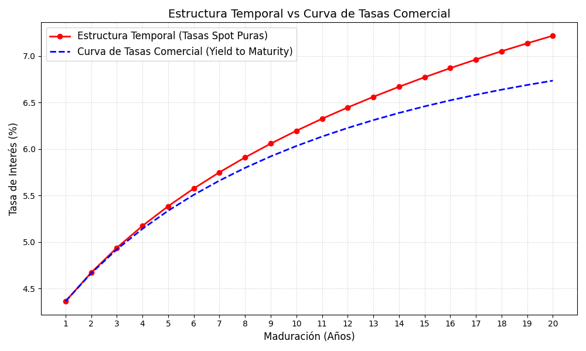

# IV. Curvas de tasas

# Conceptos base

### Curva de tasas de interés

Es una **representación gráfica** que muestra cuánto cuesta el dinero a diferentes plazos en un momento específico del tiempo.

*Suponer que se pide un préstamo a un banco. El banco no cobrará la misma tasa de interés si se le promete pagar en 1 mes en comparación a pagarle en 30 años. Esa diferencia de tasas, graficada en un plano cartesiano donde el eje X es el tiempo (maduración) y el eje Y es la tasa de interés (rendimiento), es la curva de tasas.*

Es importante porque nos indica el costo del "dinero libre de riesgo" y sirve como base para valuar absolutamente cualquier otro activo financiero.

#### Yield to Maturity (YTM)

Es una tasa única que descuenta todos los flujos futuros de un bono y los iguala a su precio actual. El problema del YTM es que adume de manera irreal que cada vez que se recibe un cupón intermedio, este cupón se logra reinvertir exactamente a esa misma tasa YTM. En el mundo real, es imposible porque lasas de interés cambian dependiendo el plazo.

### Estructura temporal de tasas de interés

A menudo, los términos "Curva de Tasas" y "Estructura Temporal" se usan como sinónimos, pero hay una sutil diferencia:

- **Curva de Tasas de Interés (Yield Curve):** Es el término más general. Puede referirse a la gráfica de *cualquier* tipo de bono. Puede estar construida con bonos que pagan cupones (YTM) o bonos que no los pagan.
- **Estructura Temporal de Tasas de Interés (Term Structure):** Se refiere *exclusivamente* a la relación entre el tiempo y la tasa de interés de bonos cupón cero puros, libres de riesgo.

La Estructura Temporal nos dice exactamente cuánto rinde un peso invertido hoy y retirado en $n$ años, sin el "ruido" ni las distorsiones matemáticas que causan los pagos intermedios de cupones.

#### Tasas Spot $(s_t)$

Es el rendimiento exacto de un peso invertido hoy que no se toca hasta el periodo $t$. No hay cupones intermedios, por lo tanto, no hay riesgo de reinversión. Es la tasa verdadera del mercado para ese plazo específico.

### Valuación con YTM y tasas spot

Vamos a demostrar por qué el YTM es solo un “promedio” y cómo las tasas spot contruyen el verdadero precio del dinero.

Ejemplo: Supongamos que el mercado nos da las siguientes tasas libres de riesgo (spot) para cada año: $s_1 = 5\%$ y $s_2 = 8\%$. Un banco emite un bono a 2 años con valor nominal de $1,000 y una tasa cupón anual del 10%, Esto significa que el bono pagará un cupón de $100 pesos en el año 1, y $1,100 pesos (redención + cupón) en el año 2.

- Valuación correcta (con tasas spot)

Para encontrar el precio justo de este bono, no se usa una sola tasa. Se descuenta cada flujo a su tasa spot correspondiente:

$$
P = \text{Flujo}_1 \cdot (1+s_1)^{-1} + \text{Flujo}_2 \cdot (1+s_2)^{-2}
\\ \quad \\
= 100(1.05)^{-1} + 1100(1.08)^{-2} = 92.238+943.07 = 1038.31
$$

El precio real del bono en el mercado será de $1038.31.

- Valuación intuitiva (con YTM)

Supongamos que el anterior bono ya se está vendiendo en las pantallas de la Bolsa a $1038.31. Eñ sistema comercial de la Bolsa no publica las tasas spot, sino que calcula una única tasa promedio (el YTM) para todo el bono usando la fórmula tradicional:

$$
1038.31 = 100(1+y)^{-1} + 1100(1+y)^{-2}
$$

Resolviendo esta ecuación descubrimos que $y=7.85\%$.

**En resumen:** La Curva de Tasas comercial (YTM) siempre es un promedio distorsionado por el tamaño de los cupones. La Estructura Temporal (Spot) es la anatomía exacta del interés año con año.

### Ejemplo: Curva de interés vs Estructura temporal

Para entender la diferencia, supongamos un bono a 10 años que paga cupones anuales en donde cada año la tasa de mercado cambia. Ese bono no es un solo flujo de dinero; es un paquete de 10 flujos de dinero distintos (9 cupones pequeños y 1 pago final gigante).

- El **Yield (YTM)** o Curva de Tasas comercial nos da **una sola tasa promedio** para todo ese paquete.
- La **Tasa Spot** o Estructura Temporal te da **10 tasas distintas**,una tasa exacta para cada uno de esos años individuales.

# Modelos económicos

### Teoría de la Prima por Liquidez

Esta teoría argumenta que los inversionistas, por naturaleza, **odian el riesgo y prefieren la liquidez**. Si tú prestas tu dinero a 1 mes, tienes tu efectivo de vuelta rápido ante cualquier emergencia. Pero si lo prestas a 10 años, tu dinero queda "congelado" (pierde liquidez) y además asumes un riesgo altísimo de que la inflación o las tasas de interés cambien drásticamente en esa década. Por lo tanto, para convencer a un inversionista racional de que "congele" su dinero a largo plazo, el emisor tiene que pagarle un premio: una **Prima por Liquidez ($L_t$)**.

¿Qué dice la teoría sobre la curva? Afirma que la tasa de interés a largo plazo es igual a un promedio de las tasas cortas esperadas en el futuro, **MÁS** una prima por liquidez que va creciendo conforme aumenta el plazo. Esto explica por qué la curva de tasas "normal" siempre tiene pendiente positiva (va hacia arriba): a mayor tiempo, mayor es la prima exigida.

### Teoría de la Segmentación del Mercado

Esta teoría adopta un enfoque de "nichos". Argumenta que el mercado de bonos no es un solo océano gigante, sino una serie de albercas separadas (segmentos) divididas por el tiempo de maduración (corto, mediano y largo plazo). Asume que los participantes del mercado tienen **mandatos legales o preferencias inamovibles** y no cruzan de una alberca a otra, sin importar cuánto pague la otra alberca. El precio en cada segmento se determina *única y exclusivamente* por la oferta y la demanda de ese segmento particular.

¿Quiénes viven en cada segmento? 

- **Corto Plazo (1 mes a 1 año):** Los Bancos Comerciales. Necesitan liquidez inmediata para cubrir retiros de clientes.
- **Largo Plazo (10 a 30 años):** Los Fondos de Pensiones y Aseguradoras. Tienen que pagar jubilaciones dentro de 30 años, por lo que necesitan "calzar" sus pasivos comprando bonos a 30 años. No les importan los bonos a 1 mes.

¿Qué dice la teoría sobre la curva?: Afirma que la curva de tasas no es una línea continua, sino "puntos inconexos". Si de pronto hay mucha demanda de pensionados por bonos a 30 años, la tasa a 30 años caerá drásticamente, sin que eso afecte en absoluto a la tasa de 1 año.

### Ejemplo: Prima vs Liquidez

Imagina este escenario en el mercado actual:
- La tasa Spot a 1 año hoy ($s_1$) es del **5.00%**.
- Los modelos macroeconómicos nos dicen que, para el próximo año, se espera que la tasa a 1 año siga exactamente igual en **5.00%**.

- Visión sin Prima (expectativa): Si el dinero hoy rinde 5% y el próximo año rendirá 5%, invertir a 2 años debería rendir matemáticamente el promedio geométrico exacto: **5.00%**. La curva sería completamente plana.
- Visión con Prima por Liquidez (real): Tú, como inversionista, le dices al mercado: *"Si me atas mi dinero por 2 años enteros en lugar de 1, quiero un premio del 0.40% por perder mi liquidez"*.

Ese $0.40\%$ es la **Prima por Liquidez ($L_2$)**.

La ecuación de la Tasa Spot a 2 años ($s_2$) se convierte en:

$$
S_2 \approx \left( \frac{5.00\% + 5.00\%}{2} \right) + 0.40\% = 5.00\% + 0.40\% = \mathbf{5.40\%}

$$

Aunque la economía no cambió y las tasas a corto plazo se mantuvieron estables (5%), la curva de tasas de mercado dibujará una pendiente positiva (de 5.00% en el año 1 a 5.40% en el año 2) única y exclusivamente por el miedo de los inversionistas a perder liquidez.

# Curvas perfectas (Bootstrapping)

Como vimos en el módulo anterior, el mercado no suele vender bonos "Cupón Cero" para plazos largos (nadie quiere prestarle a un gobierno a 20 años sin recibir ni un solo pago intermedio). El mercado está lleno de bonos normales que pagan cupones.

El **Bootstrapping** es un algoritmo recursivo  que nos permite "pelar" los cupones de los bonos comerciales para revelar las verdaderas Tasas Spot que están ocultas en su interior.

1. **El Caso Base (Año 1):** Buscamos un bono a 1 año. Como solo tiene un pago al vencimiento, matemáticamente es idéntico a un bono cupón cero. De ahí extraemos nuestra primera verdad absoluta: la Tasa Spot 1 ($s_1$).
2. **La Iteración (Año 2):** Buscamos un bono a 2 años. Este bono nos pagará un cupón en el Año 1 y el principal en el Año 2.
    1. El flujo del Año 1 lo descontamos usando la $s_1$ que *ya descubrimos* en el paso anterior.
    2. La única variable desconocida en la ecuación ahora es la Tasa Spot 2 ($s_2$). Despejamos.
3. **La Recursión (Año $n$):** Para encontrar la tasa del año $n$, utilizamos las tasas $s_1, s_2, ..., s_{n-1}$ que ya descubrimos y despejamos la última variable.

### Ejemplo

Imagina un mercado simplificado donde solo existen dos bonos. Ambos tienen un valor nominal de **1,000**.

- **Bono A (1 año):** No paga cupones (Cupón Cero). Su precio de mercado es **960**.
- **Bono B (2 años):** Paga una tasa cupón del **6%** anual. Su precio de mercado es **980**.

Vamos a extraer la Estructura Temporal iterativamente.

- Paso 1: Extraer $s_1$ (El Caso Base)

Tomamos el Bono A. Como madura en un año, su único flujo de efectivo será devolver los 1,000 de valor nominal:

$$
960 = \frac{1000}{1 + S_1} \Longrightarrow S_1 = 4.166\%
$$

El dinero a un año sin riesgo rinde exactamente 4.166%.

- Paso 2: Extraer $s_2$ (La Sustitución)

Tomamos el Bono B. Su cupón es de **60** (el 6% de 1000). Tendrá dos flujos: 60 en el año 1, y 1060 en el año 2.  Sustituimos la $s_1$ que descubrimos en el Paso 1:

$$
980 = \frac{60}{(1 + s_1)^1} + \frac{1060}{(1 + s_2)^2}
\\ \quad \\
980 = \frac{60}{1.04166} + \frac{1060}{(1 + s_2)^2}
\\ \quad \\
980 = 57.60 + \frac{1060}{(1 + s_2)^2}
\\ \quad \\
922.40 = \frac{1060}{(1 + s_2)^2}
\\ \quad \\
(1 + S_2)^2 = \frac{1060}{922.40} = 1.14917
\\ \quad \\
1 + S_2 = \sqrt{1.14917} = 1.07199
\\ \quad \\
S_2 = \mathbf{7.199\%}
$$

Acabamos de construir nuestra Estructura Temporal. Las verdaderas tasas puras del mercado son:

- Tasa Spot 1: **4.166%**
- Tasa Spot 2: **7.199%**

# Tasas forward

Hasta ahora hemos calculado **Tasas Spot**, que son acuerdos que haces *hoy* para invertir tu dinero *hoy* y retirarlo en el futuro.

Una **Tasa Forward** (tasa implícita o tasa a plazo) es una tasa de interés que acordamos *hoy* para un préstamo o inversión que va a comenzar **en una fecha futura** y terminará en otra fecha aún más lejana.

Ejemplo: Vas al banco hoy y le dices: *"Quiero firmar un contrato hoy que me garantice una tasa de interés exacta para un préstamo de 1 año, pero no me des el dinero ahorita, dámelo dentro de 3 años"*. La tasa que el banco escribirá en ese contrato es una Tasa Forward aplicable del año 3 al año 4.

¿Cómo sabe el banco qué tasa ofrecerte para el futuro sin adivinar? Utiliza la Estructura Temporal (Tasas Spot) que ya existe hoy y aplica el principio de **no-arbitraje**. Este principio dicta que dos estrategias de inversión que abarcan el mismo horizonte de tiempo total y tienen el mismo riesgo, deben generar matemáticamente exactamente el mismo rendimiento.

Si quieres invertir tu dinero por 2 años, tienes dos caminos:

1. **El camino directo:** Inviertes tu dinero a la Tasa Spot de 2 años ($s_2$) y te olvidas.

2. **El camino con escalas:** Inviertes tu dinero a la Tasa Spot de 1 año ($s_1$) y, simultáneamente, firmas un contrato Forward hoy que garantice a qué tasa ($f$) vas a reinvertir ese dinero del año 1 al año 2.

Para que no haya arbitraje (ganancias mágicas sin riesgo), el Camino 1 y el Camino 2 **tienen que ser iguales:**

$$
(1 + s_t)^t \cdot (1 + f)^k = (1 + s_{t+k})^{t+k}
$$

Si queremos despejar la tasa Forward ($f$) para plazos anuales, la fórmula pura queda de la siguiente manera:

$$
f = \left[ \frac{(1 + s_{t+k})^{t+k}}{(1 + s_t)^t} \right]^{1/k} - 1
$$

Donde:

- $t$ = El año en el que *inicia* el contrato forward.
- $k$ = La *duración* del contrato forward.
- $t+k$ = El año en el que *termina* el contrato forward.

### Ejemplo

Imagina que después de hacer Bootstrapping en el mercado, descubriste las siguientes tasas puras anuales:

- Tasa Spot a 1 año ($s_1$): **4.00%**
- Tasa Spot a 2 años ($s_2$): **5.00%**

¿Cuál debe ser la tasa forward aplicable **del año 1 al año 2** para que no exista arbitraje? (Es decir, quieres asegurar hoy la tasa de un préstamo de 1 año que tomarás el próximo año). Identificamos las variables:

- Inicio en el año $t=1$
- Termina en el año $t+k=2$
- Duración del forward $k=1$

Tenemos que:

$$
f = \left[ \frac{(1+0.05)^{2}}{(1 + 0.04)} \right] - 1 = \frac{1.1025}{1.04}-1 \approx 6.0096\%
$$

La tasa forward anual aplicable del año 1 al año 2 es de **6.0096%**.
La interpretación económica de esto es profunda: Si hoy el dinero a 1 año rinde 4%, pero a 2 años rinde 5%, el mercado "esconde" la expectativa matemática de que, el próximo año, las tasas de corto plazo **van a subir** al 6%.

Esta es la razón por la cual los grandes bancos calculan tasas forward a diario: es el mapa que les dice qué espera el mercado que suceda con las tasas en el futuro.

# Interpolación

En un mundo perfecto, el gobierno emitiría bonos con maduraciones para cada año exacto: 1, 2, 3, 4, 5... Pero en el mundo real, los gobiernos y las empresas emiten deuda en "nodos" estándar de liquidez (usualmente a 2, 3, 5, 7, 10 y 30 años).

Si se necesita valuar un contrato derivado que vence exactamente en 4 años, tienes un problema: **no tienes un precio de mercado observable para el año 4**.

Para solucionar esto sin romper los modelos, la industria financiera utiliza la **Interpolación Lineal**.
La suposición matemática aquí es sencilla: asumimos que, entre dos puntos conocidos, la tasa de interés viaja en línea recta. Es decir, asume que el rendimiento crece (o decrece) a una velocidad constante por cada día o año que pasa entre esos dos puntos.

Recordemos que la ecuación para encontrar un punto $y$ desconocido entre dos puntos conocidos $(x_1, y_1)$ y $(x_2, y_2)$ es:

$$
y = y_1 + \left[ \frac{y_2 - y_1}{x_2 - x_1} \right] \cdot (x - x_1)
$$

Para las curvas de tasas, esto se traduce en:

$$
s_t = s_{anterior} + \left[ \frac{s_{siguiente} - s_{anterior}}{t_{siguiente} - t_{anterior}} \right] \cdot (t - t_{anterior})
$$

Donde:

- **$s_t:$** La tasa spot desconocida que quieres calcular.
- **$t:$** El año que falta.
